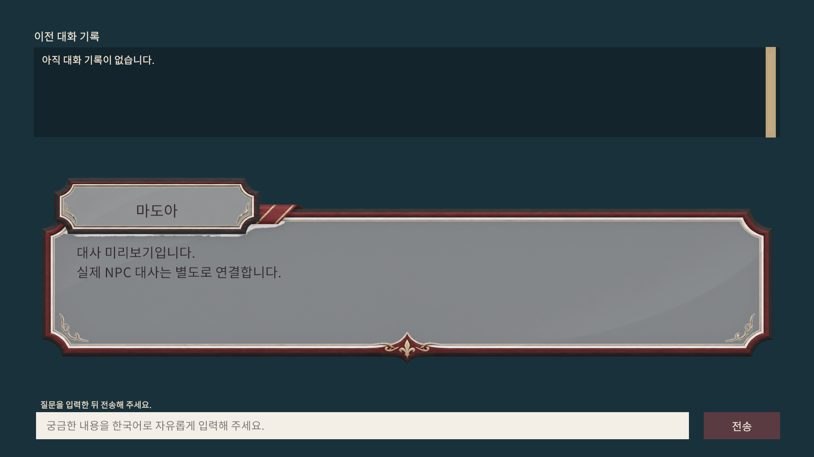

# mystery 대화 UI — 현재 열린 프로젝트에서 제작

현재 열린 `C:/UnityProjects/DeductionGame/mystery` (Unity 6000.3.26f1)에서 Unity MCP로 대화창 프리팹과 빈 미리보기 씬을 제작했습니다. 새 Unity 프로젝트를 만들지 않았습니다. 이 작업 브랜치의 [`game/UnityProject/`](game/UnityProject/README.md)는 해당 mystery에서 생성한 **UI 에셋 전달 묶음**입니다.

## 남아 있는 원본 이미지 (사용자 제공, 변경 없음)
- 대저택 대화창: `art/UI/DialogueFrames/ThemeDialogue_v1/Mansion.png`
- 크루즈 대화창: `art/UI/DialogueFrames/ThemeDialogue_v1/Cruise.png`
- 음악방송 대기실 대화창: `art/UI/DialogueFrames/ThemeDialogue_v1/MusicBroadcast.png`
- 세로형 이름표·초대장 프레임: `art/UI/CardFrames/InvitationPortrait_v2/`에 PNG 3개

## 생성한 UI

- [`DialoguePanel.prefab`](game/UnityProject/Assets/UI/Prefabs/DialoguePanel.prefab): 원본 3테마 프레임, TMP 이름/본문, 한국어 자유 입력, 전송 버튼, 이전 대화 ScrollRect.
- [`DialoguePreview.unity`](game/UnityProject/Assets/Scenes/DialoguePreview.unity): Main Camera, Canvas, EventSystem과 Canvas 아래 프리팹 인스턴스만 배치.
- 테마와 NPC는 Inspector에서 변경합니다. 화면의 버튼은 전송 버튼 하나뿐입니다.
- 상세 구성, 현재 mystery에서 여는 방법, 미검증 범위는 [제작 안내](game/UnityProject/README.md)에 기록했습니다.

기존 프로젝트 코드·맵·사건·대사 JSON은 가져오지 않았습니다. 기능 테스트·Play Mode·EXE 빌드는 실행하지 않았습니다.

## 이전 작업 복구
삭제 직전 Unity 프로젝트가 필요하다면 `archive/dialogue-prototype-before-full-reset-796cbd5-20261109` 브랜치에서 찾을 수 있습니다. 이 백업은 새 프로젝트 제작에 자동으로 적용되지 않습니다.

## 로컬 PC 안내
기존 mystery의 Project 창에서 `Assets/Scenes/DialoguePreview.unity`를 더블클릭하고, Game 탭을 Play 없이 열어 미리 봅니다. GitHub의 Assets 사본은 기존 Unity 프로젝트에 적용하는 자료이며 프로젝트를 다시 만들라는 안내가 아닙니다.
