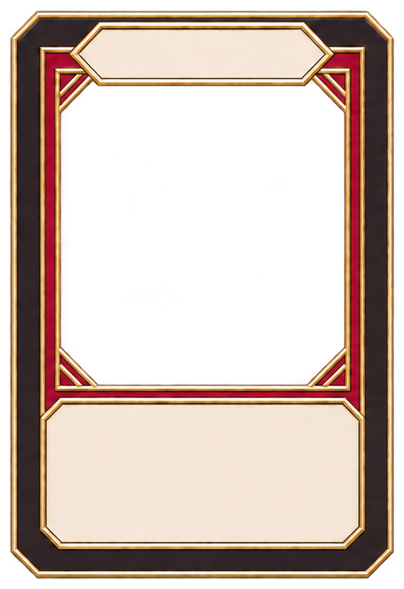
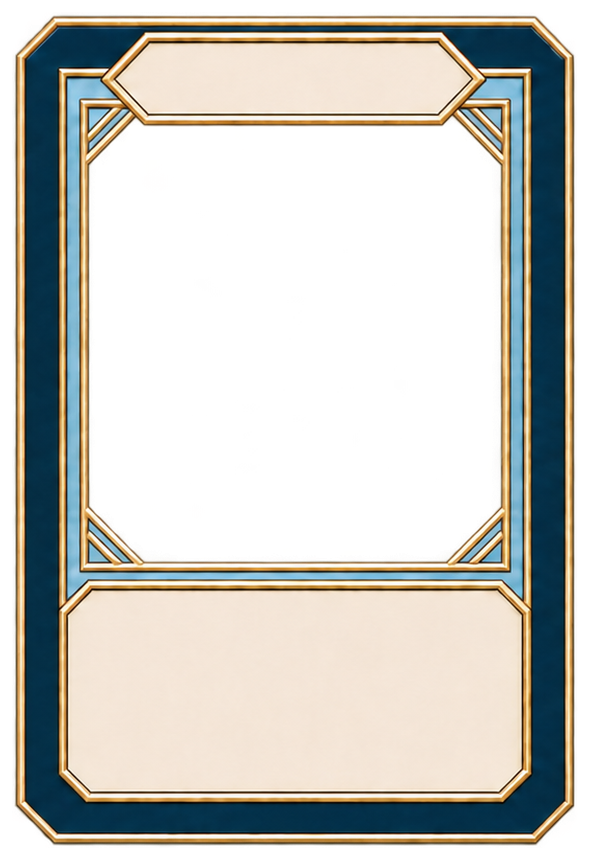
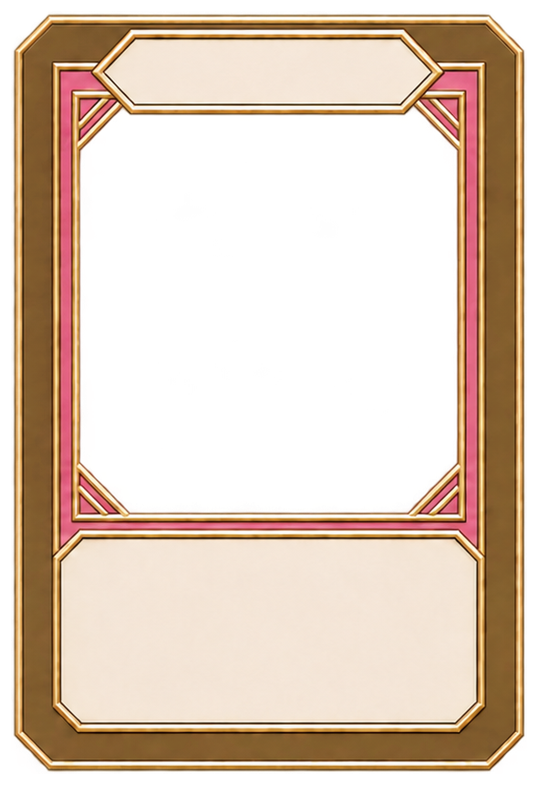

# 확정 카드 프레임 — 초대장 스타일 세로형 v2

2026-11-08 사용자 선택: 마지막 수정본(제목칸 + 설명칸 확장)을 저장.

| 파일 | 테마 | 색상 |
|---|---|---|
| Mansion.png | 대저택 (기존 문서 HOTEL 테마용 아트) | 블랙·레드 |
| Cruise.png | 크루즈 | 블루·화이트 |
| DressingRoom.png | 음악방송 대기실 | 골드·핑크 |

모두 590×860 픽셀 RGBA PNG, 중앙 피벗 (0.5,0.5). 외곽과 중앙 그림창은 투명하며, 제목칸과 설명칸은 불투명이다. 설명칸은 아래쪽을 유지하며 위로 확장했고 제목칸도 가로·높이를 확대했다. 세 파일의 캔버스와 배치 크기를 통일했다. 생성된 장식선은 테마 사이에 미세한 형태 차이가 있다.

그림은 프레임 아래 별도 레이어에 배치하고 중앙 창에 맞춰 마스킹한다. 텍스트는 제목/설명칸 위 별도 UI로 배치한다. 종횡비를 유지한다.

검증: 로컬 최종 PNG와 업로드 Git blob SHA 일치 확인, 590×860 및 RGBA 확인, 중앙 투명도와 합성 미리보기 확인. Unity 씬 연동·실행·빌드는 이번 저장 작업 범위에 포함하지 않았다. 과거 손패/카드배분 규칙을 복원하는 변경이 아니다.

