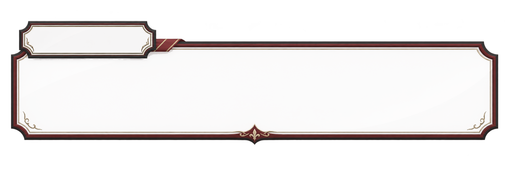
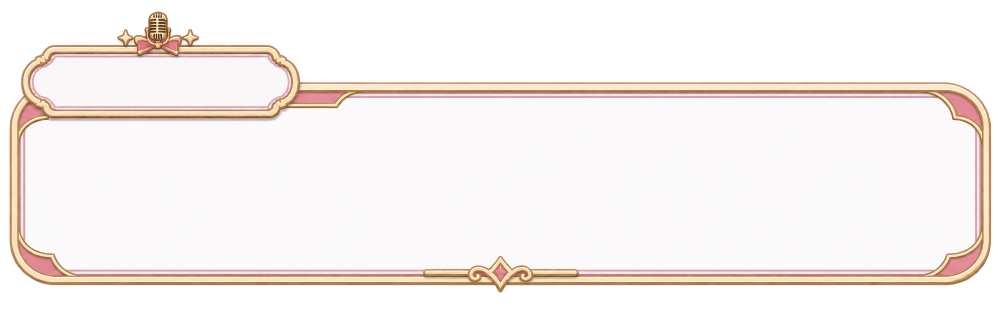

# 테마별 NPC 심문 대화창 원본 (2026-11-08)

사용자가 직접 업로드한 3개 PNG를 **화질 변경·배경 제거 재가공·재생성 없이 원본 바이트 그대로** GitHub에 보관합니다.

| 테마 | 원본 저장 파일 | 원래 첨부 파일명 | UI 톤 |
|---|---|---|---|
| `HOTEL` 대저택/호텔 | [`Mansion.png`](Mansion.png) | `01_Mansion_Hotel_alpha25_35(2).png` | 검정·버건디·금장 |
| `CRUISE` 크루즈 | [`Cruise.png`](Cruise.png) | `download.png` | 네이비·화이트·금장 |
| `MUSIC_BROADCAST` 음악방송 대기실 | [`MusicBroadcast.png`](MusicBroadcast.png) | `download(1).png` | 핑크·골드·마이크/리본 |

- **세 이미지 모두 2048×682px, RGBA 투명 PNG**입니다. 검은 영역은 이미지 배경이 아니라 미리보기의 투명 영역입니다.
- 좌측 상단 이름표와 중앙 넓은 대사창을 그대로 유지합니다. 레이아웃/장식/투명도를 임의 수정하지 않습니다.
- 게임 UI에서는 **원본 프레임 Image를 대사 텍스트보다 아래 레이어**에 두고, 이름표 위에 `TextMeshPro`로 현재 NPC의 표시명을 출력합니다. 대화 본문은 큰 패널 위에 별도 텍스트 레이어로 출력합니다.
- 여섯 표시명은 `game/characters/npc_display_profiles.v1.json` 기준 **마도아·마리예·나주아·복희·지로아·문이린**.
- 테마 ID로 자동 프레임 선택: `HOTEL -> Mansion.png`, `CRUISE -> Cruise.png`, `MUSIC_BROADCAST -> MusicBroadcast.png`.
- UI 프레임과 기존 **세로형 초대장 카드 프레임**(`art/UI/CardFrames/InvitationPortrait_v2/`)은 **다른 용도**입니다. 세로 카드는 보존하고 대화창 프레임으로 대체하지 않습니다.
- Unity 임포트 후보: `Sprite (2D and UI)`, `Alpha Is Transparency`, `Image Type: Simple`, 종횡비 유지. 이름표/대화 본문 안전 영역을 실제 해상도에서 조정합니다. 9-slicing 등 프레임 테두리가 변형되는 리샘플링은 승인 전 하지 않습니다.
- 대사는 실제 인물 지식·증거 게이트와 연동해야 합니다. **거짓말은 범인만 허용** (`game/cases/culprit_only_deception_policy.v1.json`). 승인되지 않은 시범 사건 대사를 실제 정답 사건으로 자동 실행하지 않습니다.
- 원본 보관과 테마/텍스트 레이어 설계만 완료했습니다. **Unity UI 프리팹/씬 적용, 기능 테스트, EXE/APK 빌드는 미실시.**

정확한 파일 SHA256/크기/테마 연결은 [`dialogue_frame_manifest.v1.json`](dialogue_frame_manifest.v1.json)을 참고.

## 미리보기

