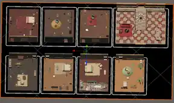

# 사건파일 No.464 — 대저택 8개 공간 맵 제작 현황 (2026-11-12)

> **출처:** 사용자가 2026-11-12 ChatGPT 대화에 직접 제공한 게임 에디터 상단 뷰 스크린샷. 해당 자료는 **사용자 제작 현황의 시각적 참고 자료**이며, GitHub 저장소의 Unity 씬·프리팹이 동일하게 갱신되었다는 의미가 아니다.
>
> **실제 스크린샷 원본:** 대화 첨부 `image(20261111-180047).png` (1048×622 px, RGBA PNG, SHA-256 `b41a7292459f930f5feb670971b51d2f1afe1d0212d4015461194c4c2a99938a`). **이 문서만으로 원본 PNG가 GitHub에 업로드된 것은 아니다.**

## GitHub에 저장된 이미지 미리보기

- [GitHub 이미지 파일](../art/Environment/References/HOTEL_8ROOM_EDITOR_OVERVIEW_20261112.webp) — 업로드 원본을 288px 너비로 축소한 **WebP 진행 현황 미리보기**. 원본 PNG의 완전한 대체 파일이 아니다.
- 원본 PNG(1048×622)는 현재 대화 첨부에 있으며 **GitHub에는 미저장**. 나중에 원본 품질 파일이 필요하면 원본 PNG와 실제 Unity 씬/프리팹을 별도로 등록해야 한다.

## 사용자가 완료했다고 보고한 부분
- 대저택 테마에 해당하는 **가구·장식이 채워진 조사 공간 8개**의 시각 배치를 제작했다.
- 제공된 이미지에서 위쪽 4개, 아래쪽 4개 실내 공간과 검은색 외곽 스테이지를 확인할 수 있다.
- 여러 공간에 침실, 응접/휴식 공간, 큰 계단이 있는 홀 등 서로 구분되는 인테리어가 보인다.
- 현재는 에디터 화면 캡처다. 맵 저장 형식, 공간별 GameObject 이름, 문·계단의 실제 이동 경로, 충돌, 카메라/플레이 모드 상태는 이 이미지로 검증할 수 없다.
- 스크린샷 속 좌상/우상 배치가 정식 101~204호에 해당하는지는 **아직 매핑 확인 전**이다. 시각적 위치를 추측해서 방 ID로 고정하지 않는다.

## 유효한 게임 설계 기준 (변경 금지)
- 공식 게임: 사건파일 No.464 / Windows PC x64 / Unity 6 URP / 탐정 1명 + NPC 용의자 6명.
- 대저택/HOTEL 테마의 논리 공간 정확히 8개. 1F: `LOBBY`, `ROOM_MATTO`(101·**마도은**), `ROOM_JIRO`(102·**진서아**), `ROOM_BOKI`(103·**김보희**). 2F: `ROOM_MARIHI`(201·**마혜인**), `ROOM_NAZ`(202·**나지수**), `ROOM_MOONIRE`(203·**문이현**), `CRIME_SCENE`(204·살해 현장).
- 이동용 복도·계단은 9번째 조사 공간으로 계산하지 않는다. 시각적인 4+4 배열이 **한 층의 방 8개**라는 뜻은 아니며, 기존 1F/2F 규칙과 일치시켜야 한다.
- 내부 논리 ID·캐릭터 ID·기존 검수 대사 원문은 유지. 플레이어 UI에만 최신 한국 이름을 표시.
- 범인은 6명 중 한 명이 매 판 변경되며, 수법·흉기·증거·동선·범인의 거짓 진술도 함께 인과적으로 구성한다. 무고한 NPC는 거짓말 금지.
- 흉기 실물은 NPC 개인실 6곳에 각 3개씩, 총 18개 실물/12종. 로비·현장에는 흉기 실물이 아닌 증거 흔적을 둔다.
- 최종 고발은 한국어 자유 입력 `범인+범행수법+흉기`; 장소는 채점하지 않는다.

## 다음 제작 단계 (우선순위)
1. **실제 Unity 씬/프리팹 저장본 확보 및 버전 연결:** 8방 에디터 작업이 담긴 원본 `.unity`, 프리팹·메타·참조 에셋을 프로젝트에 안전하게 저장한다. 이미지로 3D 씬을 복구할 수 없다. 기존 작업을 덮어쓰거나 강제 초기화하지 않는다.
2. **RoomId 바인딩:** 8개 영역의 `Collider/Trigger` 또는 클릭 선택용 `RoomAnchor`를 논리 `roomId`에 연결. 방 이름, 층수(1F/2F), 탐색 가능한 범위를 서로 일치시킨다. 편집기 실물 위치는 사용자 제작 원본을 따른다.
3. **카메라 상태:** 검은 외곽+고각 60° 전체 맵 → 층별 보기 → 방 포커스 → 물건 조사 근접 화면. 지붕/전면벽은 카메라 연출상 가림만 조정한다.
4. **문·계단/충돌:** 실제 1F↔2F 이동 규칙, 벽·가구 장애물, 문 상호작용·접근성을 연결. 별도의 9번째 조사방 추가 금지.
5. **가장 작은 완결 조사 루프:** 204호 현장 물건 1개, NPC 개인실 단서 1개, 증거 노트 저장, NPC 1명과 자유 질문/승인된 대사 선택 연결. 시작부터 전체 랜덤 사건을 연결하지 않는다.
6. **사건 엔진 통합:** 검수된 사건 템플릿 + 시드 + 범인/수법/흉기 + 진술/물증 + 유일해/접근성 검증. 기존 미승인 `Mansion.json`의 고정 범인 시범본과 9개 조사 위치를 그대로 본편에 연결하지 않는다.
7. **전체 6 NPC / 추리보드 / 자유 한국어 최종 고발 / 엔딩** 순서로 확장.

## 현재 검증 상태
- [x] 사용자가 8개 공간의 3D 맵을 만들었다고 보고함.
- [x] 사용자 제공 스크린샷에서 4+4 가구 배치 확인.
- [x] 확정된 8방·6 NPC 및 신규 표시명 설계와 맞춘 진행 기록 작성.
- [ ] 실제 Unity 씬과 프리팹을 이 변경에서 업로드·연결했는지 확인.
- [ ] 8개 RoomAnchor, 층 연결, 카메라 및 상호작용 구현.
- [ ] 플레이 모드/기능 테스트/빌드 (사용자 명시 요청 이전 수행 금지).

관련 기준: [HOTEL_LAYOUT.md](../HOTEL_LAYOUT.md), [GAME_RULES.md](../GAME_RULES.md), [UNITY_MAP_MASTERPLAN_20261110.md](../UNITY_MAP_MASTERPLAN_20261110.md), [game/maps/cutaway_camera_presentation.v1.json](maps/cutaway_camera_presentation.v1.json).
